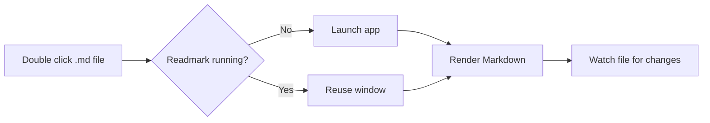
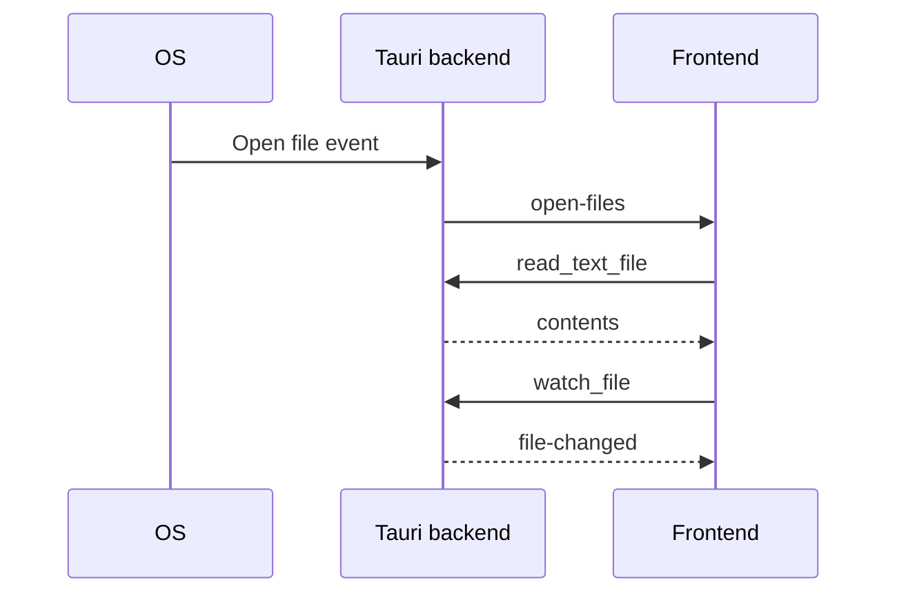
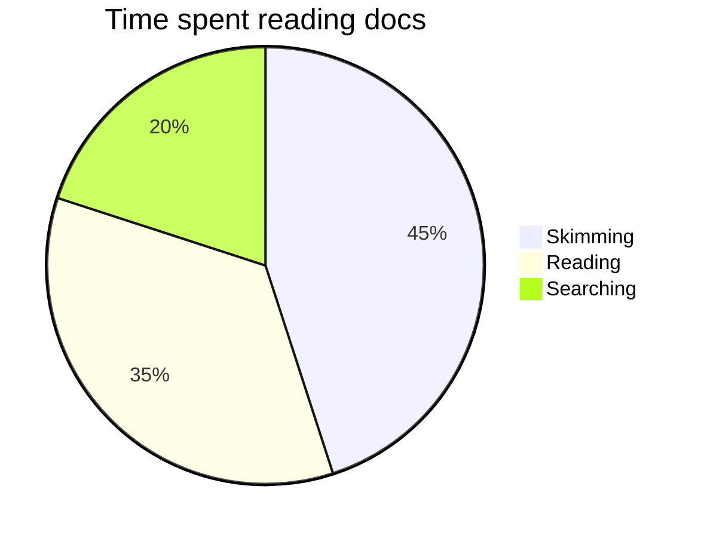

# Readmark Feature Tour

This document shows every feature Readmark supports. Edit and save it in another editor while it is open, and the view reloads automatically.


## Contents

- [Text formatting](#text-formatting)
- [Lists and task lists](#lists-and-task-lists)
- [Tables](#tables)
- [Code blocks](#code-blocks)
- [Math](#math)
- [Diagrams](#diagrams)
- [Footnotes](#footnotes)
- [Links](#links)
- [HTML and sanitizing](#html-and-sanitizing)

## Text formatting

Plain paragraphs with **bold**, *italic*, ***bold italic***, ~~strikethrough~~, and `inline code`.
Bare URLs are linked automatically: https://tauri.app

> Blockquotes are useful for notes and citations.
>
> > They can be nested, too.

---

### Heading level 3
#### Heading level 4
##### Heading level 5
###### Heading level 6

## Lists and task lists

1. First ordered item
2. Second ordered item
   - A nested bullet
   - Another nested bullet
3. Third ordered item

- [x] Render GitHub flavored Markdown
- [x] Highlight code
- [ ] View PDFs (coming later)
- [ ] Annotate PDFs

## Tables

| Feature        | Library         | Status | Size  |
| :------------- | :-------------- | :----: | ----: |
| Markdown       | markdown-it     |   ✅   | 100 kB |
| Math           | KaTeX           |   ✅   | 260 kB |
| Diagrams       | Mermaid         |   ✅   | lazy  |
| Highlighting   | highlight.js    |   ✅   | 120 kB |
| Sanitizing     | DOMPurify       |   ✅   | 20 kB |

## Code blocks

Hover over a code block to show the **Copy** button.

```rust
use std::collections::HashMap;

fn word_count(text: &str) -> HashMap<&str, usize> {
    let mut counts = HashMap::new();
    for word in text.split_whitespace() {
        *counts.entry(word).or_insert(0) += 1;
    }
    counts
}
```

```javascript
// Debounce a function call
export function debounce(fn, ms = 100) {
  let timer;
  return (...args) => {
    clearTimeout(timer);
    timer = setTimeout(() => fn(...args), ms);
  };
}
```

```python
from dataclasses import dataclass

@dataclass
class Point:
    x: float
    y: float

    def length(self) -> float:
        return (self.x ** 2 + self.y ** 2) ** 0.5
```

```diff
- const theme = "light";
+ const theme = matchMedia("(prefers-color-scheme: dark)").matches ? "dark" : "light";
```

```
A code block without a language is shown without highlighting.
```

## Math

Inline math uses single dollar signs: the mass–energy equivalence $E = mc^2$, or Euler's identity $e^{i\pi} + 1 = 0$.

Display math uses double dollar signs:

$$
\int_{-\infty}^{\infty} e^{-x^2}\,dx = \sqrt{\pi}
$$

$$
\mathbf{A} = \begin{pmatrix} a_{11} & a_{12} \\ a_{21} & a_{22} \end{pmatrix},
\qquad
\det(\mathbf{A}) = a_{11}a_{22} - a_{12}a_{21}
$$

$$
\sum_{n=1}^{\infty} \frac{1}{n^2} = \frac{\pi^2}{6}
$$

## Diagrams

Mermaid diagrams follow the light or dark system theme.







## Footnotes

Readmark supports footnotes[^1], including longer ones with several paragraphs[^long].

[^1]: This is a short footnote.
[^long]: This is a longer footnote.

    It has a second paragraph, indented by four spaces.

## Links

- External links open in your default browser: [Tauri](https://tauri.app)
- Links to headings scroll within the page: [back to the top](#readmark-feature-tour)
- Links to other Markdown files open them in Readmark: [README](README.md)
- Email links open your mail client: <mailto:someone@example.com>

## HTML and sanitizing

Inline HTML such as <kbd>Ctrl</kbd> + <kbd>C</kbd>, <mark>highlighted text</mark>, and collapsible sections works:

<details>
<summary>Click to expand</summary>

Hidden content, with **Markdown** inside.

</details>

Dangerous HTML is removed by DOMPurify. The script and the `onerror` handler below never run:

<script>alert("This never runs")</script>

